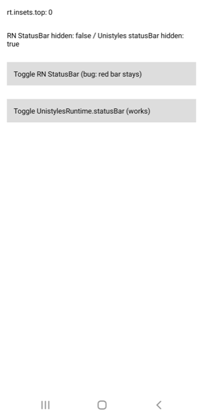
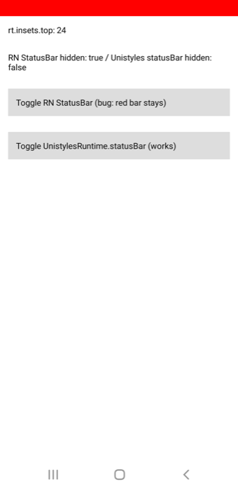

# Unistyles repro: `rt.insets.top` stays when the status bar is hidden via `WindowInsetsControllerCompat` (Android ≤ 10)

On Android 10 and lower, hiding the status bar with React Native's `StatusBar` (with `edgeToEdgeEnabled=true`) leaves `rt.insets.top` at the status bar height. Hiding it with `UnistylesRuntime.statusBar.setHidden(true)` reports `0`.

- react-native 0.86.2
- react-native-unistyles 3.8.2
- react-native-nitro-modules 0.37.1
- `android/gradle.properties`: `edgeToEdgeEnabled=true`

## Run

```sh
npm install
npx react-native run-android
```

Use an Android 10 or lower device or emulator. The repro was recorded on a Samsung Galaxy A8 2018 (Android 9 / API 28).

## Steps

1. The red bar at the top has height `rt.insets.top`.
2. Tap **Toggle UnistylesRuntime.statusBar**. The status bar hides and the red bar disappears.
3. Tap it again. The status bar and the red bar come back.
4. Tap **Toggle RN StatusBar**. The status bar hides, but the red bar stays at the status bar height (`rt.insets.top: 24`).

## Recording

[docs/repro-android9.mp4](docs/repro-android9.mp4)

| `UnistylesRuntime.statusBar.setHidden(true)` | `<StatusBar hidden />` |
|---|---|
|  |  |

The repro code is in [`src/App.tsx`](src/App.tsx).
